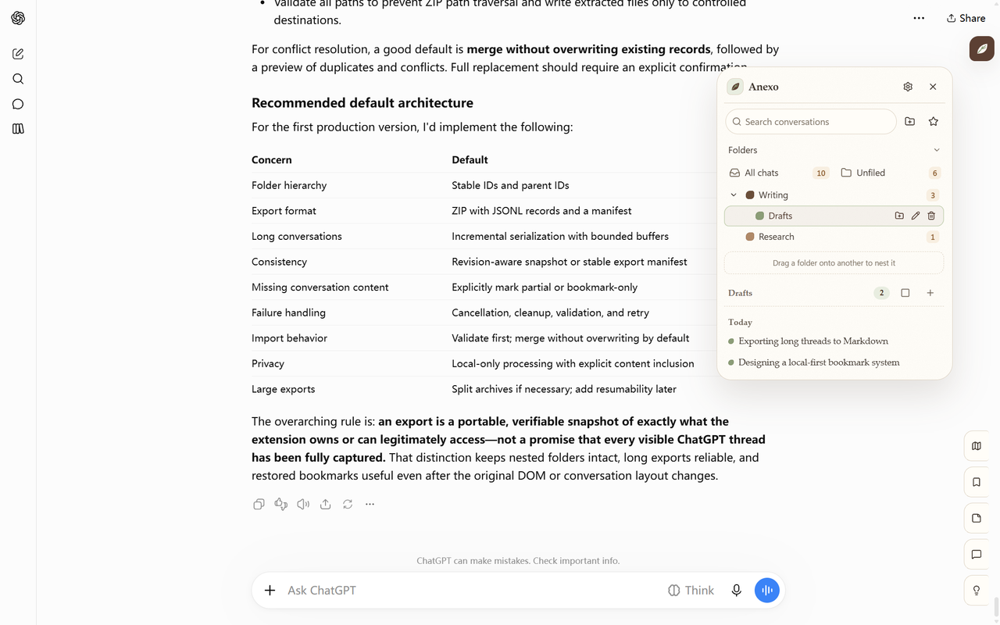
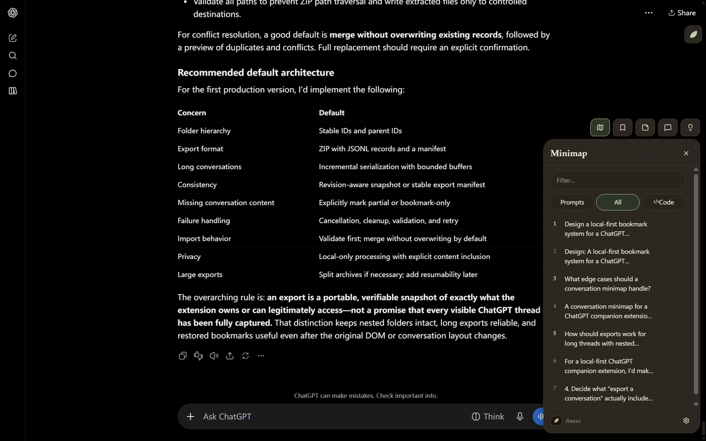
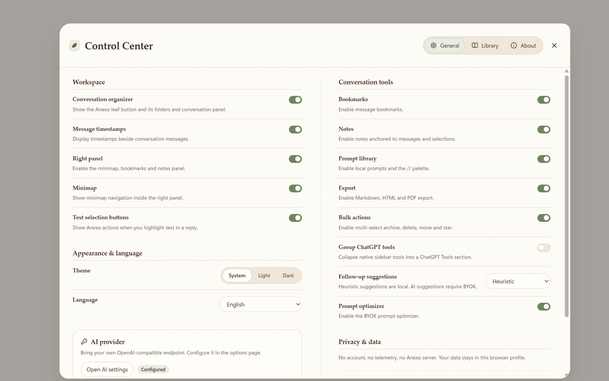
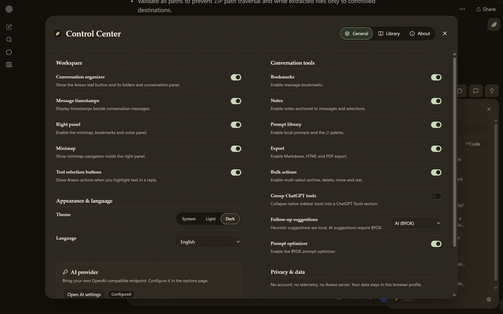
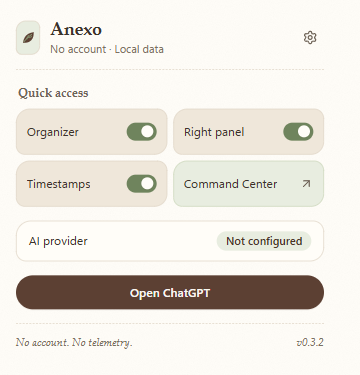

# Anexo

A local-first, open-source ChatGPT companion for Chrome. Organize conversations into folders, keep
bookmarks and notes, navigate long threads with a minimap, export your work, and bring your own AI —
without an account, subscription, or telemetry.

> Anexo is an independent project. It is not affiliated with OpenAI or any other provider.

## Screenshots

### Conversation organizer

A leaf button sits below ChatGPT's Share control and opens the organizer as a floating drawer. The
drawer closes on an outside click or Escape, and ChatGPT's own sidebar stays untouched.



### Right rail

A floating tool tray keeps the minimap, bookmarks, notes, Side Chat, and follow-ups within reach. It
keeps its vertical dock when closed and expands into a horizontal tab bar when open.



### Control Center

Workspace, conversation tools, appearance, privacy, and AI settings live in one two-column ledger.

<table>
  <tr>
    <td width="50%"></td>
    <td width="50%"></td>
  </tr>
  <tr>
    <td align="center">Light</td>
    <td align="center">Dark</td>
  </tr>
</table>

### Popup

Quick access to the organizer, right panel, timestamps, and the Control Center.

<p align="center">
  
</p>

## Features

- **Conversation organizer** — nested folders with an eight-color palette chosen at creation,
  drag-to-nest and sibling reordering, local search, star filters, time buckets, infinite scroll,
  bulk selection, and Markdown/HTML/ZIP export.
- **Real ChatGPT actions** — deleting a conversation in Anexo deletes it from ChatGPT, then clears
  its local folder assignment, bookmarks, and notes. A new chat started from a folder is filed there
  as soon as ChatGPT assigns the real conversation id.
- **Right rail** — minimap with search and jump-to-message, bookmarks, anchored notes, Side Chat
  grounded in the current conversation, and follow-up suggestions (local heuristic or BYOK AI).
- **Prompt library** — local prompts, a `//` composer trigger, JSON import/export, and click-to-insert.
  New prompts can be polished by the configured AI provider before saving, and the composer's polish
  chip appears only while you are writing.
- **Exports** — Markdown and self-contained HTML for any conversation, plus a bulk ZIP with both
  formats for selected conversations.
- **BYOK AI** — any OpenAI-compatible endpoint, with presets for OpenAI, Anthropic, OpenRouter,
  Groq, Ollama, and LM Studio. Reasoning effort, thinking budget, temperature, output limit,
  streaming, and connection testing are available. The API key stays in extension-only storage.
- **ChatGPT history** — uses your existing ChatGPT session. The short-lived bearer token is kept in
  content-script memory and never written to storage or exposed to the page.

Still missing: PDF export, inline timestamp/bookmark decorations on each turn, CSS-highlight note
anchoring, and native ChatGPT tool grouping. See [docs/parity.md](docs/parity.md).

## Privacy

Everything Anexo stores lives in `chrome.storage.local` on your device. Anexo has no server and
sends no analytics. Requests to ChatGPT use your existing ChatGPT session. AI requests go directly
from the extension background to the provider you configure. Content scripts never see API keys.
See [PRIVACY.md](PRIVACY.md).

## Install

### From a release

1. Download the latest `anexo-<version>-chrome.zip` from
   [Releases](https://github.com/duzui300/Anexo/releases/latest).
2. Unzip it.
3. Open `chrome://extensions`, enable **Developer mode**, and choose **Load unpacked** for the unzipped
   folder.

### From source

```bash
npm install
npm run icons        # regenerate PNG icons from public/logo.svg
npm run dev          # WXT dev mode
```

Then open `chrome://extensions`, enable Developer mode, and load the unpacked build from
`.output/chrome-mv3-dev` (or run `npm run build` and load `.output/chrome-mv3`).

## Development

```bash
npm run typecheck
npm run lint
npm run test
npm run test:e2e
npm run check        # typecheck + lint + unit tests + build + forbidden-string scan
npm run mock:openai  # local OpenAI-compatible mock on :11435
```

Architecture and design notes live in [`docs/`](docs/). The test build (`E2E=1 npm run build`)
pre-grants the local mock provider origin so Playwright can skip Chrome's native optional-permission
prompt; production builds request that host permission on demand from the options page.

## License

MIT. See [LICENSE](LICENSE) and [THIRD_PARTY_NOTICES.md](THIRD_PARTY_NOTICES.md).
